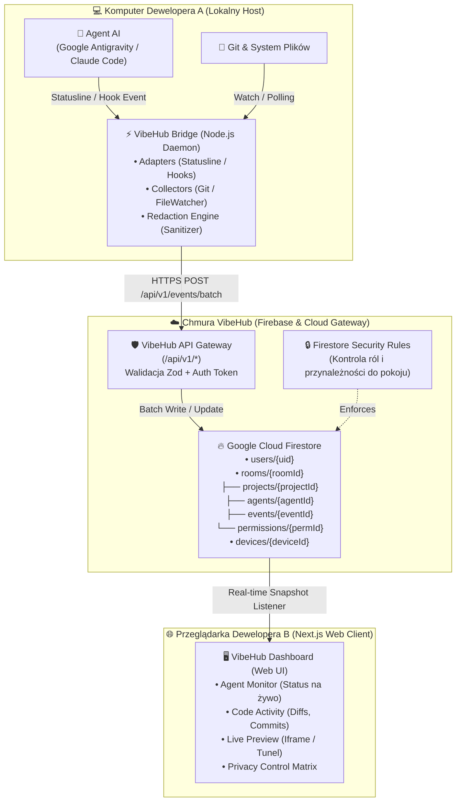

# 🏛️ VIBEHUB // SYSTEM ARCHITECTURE & COMPONENT BOUNDARIES
> Dokument nadrzędny architektury systemu VibeHub MVP v0.1.
> Wersja: v0.1.6 | Data: 2026-10-20 | Status: PRODUKCYJNA (STABLE) | Autorzy: Antigravity & Operator

---

## 1. MISJA I PARADYGMATY ARCHITEKTONICZNE

**VibeHub** to platforma obserwowalności pracy autonomicznych i półautonomicznych agentów AI w modelu **Local-First & Multi-Agent Collaboration**.
Główna zasada inżynieryjna: **VibeHub raportuje wyłącznie twarde, wiarygodnie zweryfikowane fakty z lokalnego środowiska deweloperskiego, eliminując stan fantomowy i zgadywanie.**

### Paradygmaty Podstawowe
1. **Local-First Agent Observability:** Agent i stacja deweloperska pozostają pod pełną kontrolą użytkownika. Lokalny proces demona (`Bridge`) zbiera telemetrię i wysyła ją jako zredagowane zdarzenia.
2. **Zero Inbound Remote Execution (Brak Zdalnego Sterowania w MVP):** Bridge jest jednostronnym obserwatorem lokalnym (telemetria outbox), a nie serwerem SSH/RCE. Przeglądarka drugiego programisty NIE ma bezpośredniego dostępu do shella ani plików stacji źródłowej.
3. **Wielopoziomowa Granulacja Obserwowalności (L1-L4):**
   - **L1 — Projekt (System Plików & Git):** Ścieżki projektowe, gałęzie Git, status `git status`, commity, lista modyfikowanych plików.
   - **L2 — Agent (Cykl Życia & Narzędzia):** Status (`working`, `waiting`, `idle`, `error`), identyfikator sesji, typy wywoływanych narzędzi (np. `run_command`, `replace_file_content`).
   - **L3 — Kontekst (Zredagowane Wyjścia & Zadania):** Aktywność zadaniowa, zanonimizowane wyjścia narzędzi (tylko za jawną zgodą użytkownika i wsparciem adaptera).
   - **L4 — Wizualizacja (Live Preview & Screen):** Adresy URL lokalnych serwerów dev (tunel HTTPS / dev server), zrzuty ekranu UI (opcjonalne migawki).
4. **Zero Trust & Data Redaction:** Domyślne wycinanie plików `.env`, kluczy API, tokenów, haseł, baz SQLite oraz katalogów `node_modules`, `.git`, `dist`, `target`.

---

## 2. PRZEPŁYW DANYCH (DATA FLOW PIPELINE)



---

## 3. TOPOGRAFIA REPOZYTORIUM (MONOREPO TREE)

Struktura oparta na **pnpm workspaces** ze ścisłym podziałem na aplikacje (`apps/`) oraz współdzielone biblioteki (`packages/`):

```text
vibehub/
├── apps/
│   ├── web/                         # Frontend: Next.js 15+ (App Router) + React 19 + Tailwind CSS
│   │   ├── app/
│   │   │   ├── (auth)/              # Logowanie / Rejestracja Firebase Auth
│   │   │   │   ├── login/
│   │   │   │   └── register/
│   │   │   ├── (dashboard)/         # Panel główny użytkownika
│   │   │   │   ├── dashboard/       # Przegląd aktywnych pokoi i urządzeń
│   │   │   │   ├── rooms/
│   │   │   │   │   └── [roomId]/    # Widok pokoju współpracy (Room View)
│   │   │   │   ├── projects/
│   │   │   │   │   └── [projectId]/ # Szczegóły projektu, diffy, historia commitów
│   │   │   │   └── settings/        # Ustawienia profilu, urządzenia, tokeny parowania
│   │   │   ├── api/                 # Next.js API Routes (Serverless Gateway / Proxy)
│   │   │   │   └── v1/
│   │   │   │       ├── bridge/      # /pair, /heartbeat
│   │   │   │       ├── projects/    # /register
│   │   │   │       ├── agents/      # /snapshot
│   │   │   │       └── events/      # /batch
│   │   │   ├── layout.tsx
│   │   │   └── page.tsx
│   │   ├── components/              # Komponenty domenowe i widoki
│   │   │   ├── agent-monitor/       # Widgety statusu agenta, karty akcji
│   │   │   ├── code-activity/       # Wizualizacje zmian plików, strumień commitów
│   │   │   ├── live-preview/        # Podgląd iframe/embed, detekcja hosta
│   │   │   ├── privacy-control/     # Matryca zgód L1-L4 dla pokoju/projektu
│   │   │   ├── rooms/               # Lista członków, zaproszenia, status obecności
│   │   │   └── ui/                  # Komponenty bazowe (Button, Modal, Input, Badge, Table)
│   │   ├── hooks/                   # Customowe hooki (useRoom, useAgent, useFirestore)
│   │   ├── lib/                     # Firebase Client SDK, utils, formatters
│   │   ├── package.json
│   │   └── tsconfig.json
│   │
│   └── bridge/                      # Lokalny demon: Node.js + TypeScript
│       ├── src/
│       │   ├── adapters/            # Adaptery środowisk AI
│       │   │   ├── antigravity/     # Statusline listener + CLI runner
│       │   │   ├── claude-code/     # Hooks listener / IPC socket
│       │   │   └── cursor/          # Adapter Cursora / IDE Agent
│       │   ├── collectors/          # Zbieracze metryk systemowych
│       │   │   ├── git/             # Detekcja branchy, commitów, staged/unstaged
│       │   │   └── file-watcher.ts  # Chokidar z filtrem EPERM i ignorowaniem Cookies/Junctions
│       │   ├── redaction/           # Silnik anonimizacji i czyszczenia sekretów
│       │   ├── transport/           # Klient HTTP z kolejką offline i ponawianiem
│       │   ├── core/                # Cykl życia demona (daemon.ts), skaner sprzętowy (scanner.ts)
│       │   ├── cli.ts               # Dwuetapowy interaktywny kwestionariusz CLI (`vibehub pair/start`)
│       │   └── index.ts             # Eksport biblioteki pakietu Bridge
│       ├── package.json
│       └── tsconfig.json
│
├── packages/
│   ├── contracts/                   # Schematy Zod + typy TypeScript dla API
│   │   ├── src/
│   │   │   ├── api/                 # Żądania i odpowiedzi endpointów /api/v1/*
│   │   │   ├── models/              # Typy modeli Firestore (Room, Agent, Project, Device)
│   │   │   └── index.ts
│   │   ├── package.json
│   │   └── tsconfig.json
│   │
│   ├── event-protocol/              # Kanoniczne definicje zdarzeń (Canonical Event Schema)
│   │   ├── src/
│   │   │   ├── events/              # Schematy konkretnych zdarzeń (agent, git, file, preview)
│   │   │   ├── validator.ts         # Walidatory integralności pakietów
│   │   │   └── index.ts
│   │   ├── package.json
│   │   └── tsconfig.json
│   │
│   ├── adapter-sdk/                 # Kontrakt integracyjny dla twórców adapterów
│   │   ├── src/
│   │   │   ├── types.ts             # Interfejs AgentAdapter, AdapterCapabilities
│   │   │   ├── base-adapter.ts      # Klasa bazowa z obsługą buforowania zdarzeń
│   │   │   └── index.ts
│   │   ├── package.json
│   │   └── tsconfig.json
│   │
│   └── ui/                          # Współdzielony system designu (Design Tokens, Theme)
│       ├── src/
│       │   ├── tokens/              # Kolory, typografia, promienie, cienie
│       │   └── index.ts
│       ├── package.json
│       └── tsconfig.json
│
├── firebase/
│   ├── firestore.rules              # Restrykcyjne reguły bezpieczeństwa bazy
│   ├── firestore.indexes.json       # Indeksy złożone dla zapytań czasu rzeczywistego
│   └── functions/                   # Opcjonalne Cloud Functions (czyszczenie retencji, webhooki)
│
├── docs/                            # Pełna dokumentacja inżynieryjna
│   ├── ARCHITECTURE.md              # Granice i decyzje systemowe
│   ├── EVENT_PROTOCOL.md            # Specyfikacja protokołu zdarzeń
│   ├── SECURITY.md                  # Model uprawnień, redakcja, poświadczenia
│   ├── ADAPTERS.md                  # Standard adapterów agentów
│   ├── TOPOGRAPHY_TREE.md           # Kompletna topografia i mapowanie komponentów
│   ├── DESIGN_SYSTEM_GUIDE.md       # Wytyczne projektowania UI/UX dla designera
│   └── versions/
│       └── v0.1.0.md                # Notatki wydania MVP v0.1
│
├── .env.example                     # Wzorzec zmiennych środowiskowych
├── .gitignore                       # Ignorowane pliki, sekrety i buildy
├── HISTORY.md                       # Dziennik zmian (append-only)
├── pnpm-workspace.yaml              # Definicja obszarów roboczych monorepo
├── package.json                     # Root scripts i devDependencies
├── ZASADYPRACY.md                   # Nadrzędny protokół sesji Antigravity
└── README.md                        # Wprowadzenie i instrukcja uruchomienia
```

---

## 4. MODEL DANYCH FIRESTORE (SCHEMAT KOLEKCJI)

| Kolekcja / Dokument | Odpowiedzialność | Kluczowe Pola |
| :--- | :--- | :--- |
| `users/{userId}` | Profil programisty | `displayName`, `email`, `avatarUrl`, `lastActiveAt`, `createdAt` |
| `rooms/{roomId}` | Pokój współpracy | `name`, `ownerId`, `memberIds: string[]`, `createdAt`, `updatedAt` |
| `rooms/{roomId}/projects/{projectId}` | Rejestr projektów w pokoju | `ownerId`, `name`, `rootPathRedacted`, `gitRepo`, `branch`, `sharedLevels: L1-L4`, `updatedAt` |
| `rooms/{roomId}/agents/{agentId}` | Aktywny stan agenta AI | `ownerId`, `projectId`, `deviceId`, `provider`, `status`, `activity`, `capabilities`, `lastObservedAt`, `statusExpiresAt` |
| `rooms/{roomId}/events/{eventId}` | Dziennik zdarzeń pokoju | `schemaVersion`, `occurredAt`, `receivedAt`, `source`, `type`, `projectId`, `deviceId`, `data: object` |
| `rooms/{roomId}/permissions/{permId}` | Macierz uprawnień | `projectId`, `allowedUserIds`, `allowedLevels: string[]`, `grantExpiresAt` |
| `devices/{deviceId}` | Zarejestrowana stacja robocza | `ownerId`, `hostname`, `bridgeVersion`, `lastHeartbeatAt`, `status: online/offline`, `pairedAt` |

---

## 5. STANDARDY IMPLEMENTACYJNE & REJESTR DECYZJI

1. **Język i Środowisko:** TypeScript 5.5+, Node.js 22+ (kompatybilne z Node 26 LTS), Next.js 15+ App Router.
2. **Stylizacja UI:** Tailwind CSS v4, dark-tech aesthetic, akcenty cyan/indigo/emerald/violet, pełne wsparcie stanów interaktywnych (hover/active/focus/disabled).
3. **Zarządzanie Stanem:** Zustand (klient Web) + TanStack Query / Firestore onSnapshot (dane chmurowe w czasie rzeczywistym).
4. **Walidacja Schematów:** Zod jako jedyne źródło prawdy dla kontraktów API i zdarzeń telemetrii.
5. **Dług Techniczny i Ograniczenia v0.1:**
   - Brak bezpośredniego proxy WebRTC w MVP (podgląd przez tunel/public URL lub okresowe migawki).
   - Przechowywanie zdarzeń z retencją 7 dni (zmniejszenie kosztów bazy).
