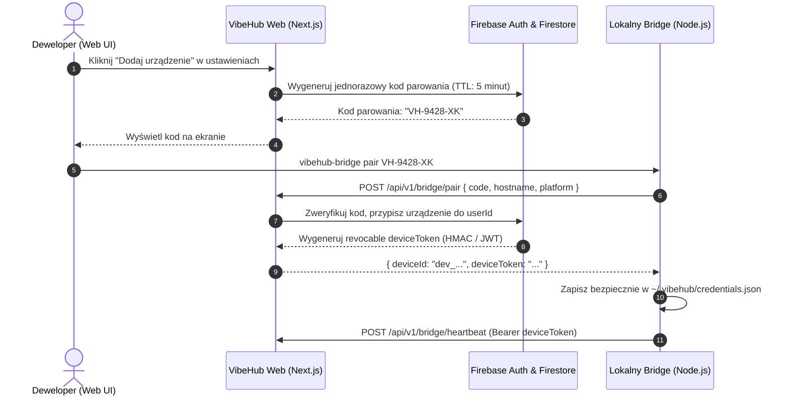

# 🔒 VIBEHUB // BEZPIECZEŃSTWO I POLITYKA PRYWATNOŚCI (SECURITY.md)
> Standard ochrony tożsamości, poświadczeń, danych projektowych i integralności komunikacji.
> Status: PRODUKCYJNY | Model: Zero Trust & Local Boundary Protection

---

## 1. ZASADY FUNDAMENTALNE ARCHITEKTURY BEZPIECZEŃSTWA

1. **Izolacja Systemu Plików i Terminala (Zero Inbound RCE):**
   - Lokalny Bridge jest wyłącznie klientem wysyłającym telemetrię na serwer.
   - Żaden zewnętrzny uczestnik pokoju ani backend nie posiada uprawnień do zdalnego wywołania poleceń w shellu komputera źródłowego.
2. **Niezależność Uprawnień:**
   - Samo członkostwo w pokoju (`rooms/{roomId}`) nie uprawnia automatycznie do podglądu kodu, diffów ani podglądów aplikacji.
   - Każdy projekt posiada własną matrycę zgód (`permissions`), definiującą poziomy obserwowalności (L1-L4) dla poszczególnych użytkowników.
3. **Brak Sekretów w Bazie:**
   - Klucze API, hasła, tokeny dostępowe oraz pliki `.env` są odfiltrowywane na poziomie lokalnego hosta przed wysłaniem zdarzenia.

---

## 2. PROCEDURA PAROWANIA I POŚWIADCZENIA BRIDGE



- **Unieważnianie Urządzenia:** Użytkownik w dowolnym momencie może kliknąć "Odłącz urządzenie" w dashboardzie, co natychmiast unieważnia `deviceToken` i blokuje kolejne pakiety zdarzeń z danej stacji.

---

## 3. SILNIK REDAKCJI DANYCH (DATA REDACTION ENGINE)

Przed wysłaniem jakiegokolwiek zdarzenia typu `file.changed`, `tool.started` lub `git.commit_created`, lokalny Bridge przetwarza dane przez **Sanitizer**:

### 3.1. Czarna Lista Ścieżek (Strict Path Denylist)
Zdarzenia dotyczące poniższych ścieżek są całkowicie odrzucane i nie trafiają do bufora:
- Pliki środowiskowe: `.env`, `.env.*`, `*.env`
- Klucze i certyfikaty: `*.pem`, `*.key`, `*.cert`, `*.pfx`, `id_rsa*`
- Poświadczenia chmurowe: `service-account*.json`, `google-credentials*.json`, `*.credentials`
- Bazy danych i magazyny lokalne: `*.sqlite`, `*.db`, `*.dump`
- Katalogi zależności i cache: `node_modules/`, `.git/`, `.next/`, `dist/`, `build/`, `.idea/`, `.vscode/`

### 3.2. Wykrywanie Wrażliwych Wzorców (Entropy & Pattern Regex)
Sanitizer skanuje treść wiadomości commitów oraz nagłówki aktywności narzędzi pod kątem:
- Kluczy OpenAI / Anthropic / Gemini: `(sk-[a-zA-Z0-9]{20,})`, `(AIza[a-zA-Z0-9_-]{35})`
- Tokenów GitHub: `(ghp_[a-zA-Z0-9]{36})`, `(github_pat_[a-zA-Z0-9_]{50,})`
- Haseł i connection stringów: `(password=[\S]+)`, `(mongodb(\+srv)?:\/\/[\S]+)`
Wszelkie dopasowane fragmenty są maskowane wartością `[REDACTED_SECRET]`.

---

## 4. REGUŁY BEZPIECZEŃSTWA FIRESTORE (SECURITY RULES ARCHITECTURE)

```javascript
rules_version = '2';
service cloud.firestore {
  match /databases/{database}/documents {
    
    // Funkcje pomocnicze
    function isAuthenticated() {
      return request.auth != null;
    }
    
    function isUser(userId) {
      return isAuthenticated() && request.auth.uid == userId;
    }
    
    function isRoomMember(roomId) {
      return isAuthenticated() && 
        request.auth.uid in get(/databases/$(database)/documents/rooms/$(roomId)).data.memberIds;
    }
    
    function isRoomOwner(roomId) {
      return isAuthenticated() && 
        request.auth.uid == get(/databases/$(database)/documents/rooms/$(roomId)).data.ownerId;
    }

    // Kolekcja użytkowników
    match /users/{userId} {
      allow read: if isAuthenticated();
      allow write: if isUser(userId);
    }

    // Urządzenia programistów
    match /devices/{deviceId} {
      allow read, write: if isAuthenticated() && resource.data.ownerId == request.auth.uid;
      allow create: if isAuthenticated() && request.resource.data.ownerId == request.auth.uid;
    }

    // Pokoje współpracy
    match /rooms/{roomId} {
      allow read: if isRoomMember(roomId);
      allow create: if isAuthenticated();
      allow update, delete: if isRoomOwner(roomId);

      // Projekty w pokoju
      match /projects/{projectId} {
        allow read: if isRoomMember(roomId);
        allow create, update, delete: if isRoomMember(roomId) && 
          request.resource.data.ownerId == request.auth.uid;
      }

      // Stan agentów
      match /agents/{agentId} {
        allow read: if isRoomMember(roomId);
        allow write: if false; // Zapis wyłącznie przez autoryzowane API Backend (Cloud Functions / Service Account)
      }

      // Strumień zdarzeń pokoju
      match /events/{eventId} {
        allow read: if isRoomMember(roomId);
        allow write: if false; // Zapis wyłącznie przez autoryzowany endpoint /api/v1/events/batch
      }

      // Uprawnienia i zgody
      match /permissions/{permId} {
        allow read: if isRoomMember(roomId);
        allow write: if isRoomOwner(roomId);
      }
    }
  }
}
```

---

## 5. POLITYKA RETENCJI I LIMITOWANIA ZAPYTAŃ (RATE LIMITING)

1. **Czas Przechowywania Danych (Retention Policy):**
   - **Surowe Zdarzenia (`events`):** Usuwane automatycznie po **7 dniach** przez harmonogram Cloud Functions (redukcja kosztów Firestore).
   - **Zagregowane Metryki Aktywności:** Przechowywane przez **30 dni**.
   - **Stan Agenta (`agents`):** Ważność pojedynczego snapshotu wynosi maksymalnie 60 sekund; brak heartbeat lub aktualizacji przez >30s oznacza przejście w stan `unknown` / `stale`.
2. **Ograniczenia Częstotliwości (Rate Limiting):**
   - Pojedyncze urządzenie może przesłać maksymalnie 1 pakiet zdarzeń na 2 sekundy (`/events/batch`).
   - Maksymalny rozmiar pojedynczego pakietu zdarzeń: **256 KB**.
   - Maksymalna liczba zdarzeń w jednym pakiecie: **50 zdarzeń**.
