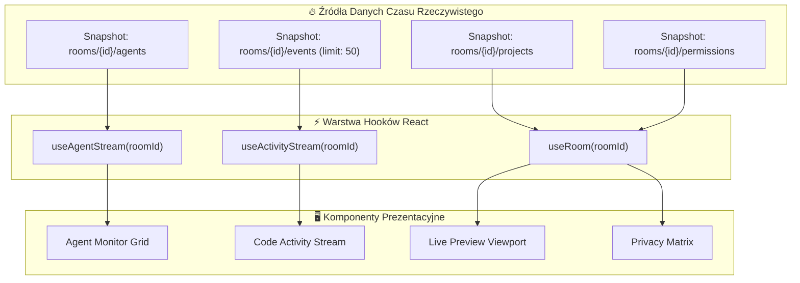

# 🗺️ VIBEHUB // TOPOGRAFIA SYSTEMU, STRON I KOMPONENTÓW (TOPOGRAPHY_TREE.md)
> Kompletna mapa hierarchiczna monorepo, routingu Next.js, komponentów UI oraz przepływu danych.
> Przeznaczenie: punkt wyjścia dla projektanta interfejsu (Design First) i inżynierów implementacji.

---

## 1. DRZEWO STRON I WIDOKÓW APLIKACJI (`apps/web`)

Wszystkie trasy zrealizowane w architekturze **Next.js App Router**:

```text
apps/web/app/
│
├── (auth)/                                  # [Strefa Niezalogowana]
│   ├── login/
│   │   └── page.tsx                         # Widok logowania (Email/Password, GitHub OAuth, Google)
│   └── register/
│       └── page.tsx                         # Rejestracja nowego użytkownika
│
├── (dashboard)/                             # [Strefa Uwierzytelniona - Główna Powłoka]
│   ├── layout.tsx                           # Globalny Shell: TopNav (HUD status) + Sidebar nawigacyjny
│   │
│   ├── dashboard/                           # [Pulpit Główny]
│   │   └── page.tsx                         # ├─ Karta statusu podłączonych urządzeń (Bridge Status)
│   │                                        # ├─ Siatka aktywnych pokoi (Active Rooms Grid)
│   │                                        # ├─ Szybkie statystyki (ilość agentów w pracy, commity dzisiaj)
│   │                                        # └─ Przycisk "Utwórz nowy pokój" / "Dołącz z kodem"
│   │
│   ├── rooms/
│   │   └── [roomId]/                        # [Główny Pokój Współpracy - Collaborative Room]
│   │       ├── page.tsx                     # ├─ HEADER POKOJU: Tytuł, lista aktywnych deweloperów (Avatary + Ping)
│   │       │                                # ├─ SEKCJA 1: AGENT MONITOR (Statusy agentów na żywo)
│   │       │                                # │   ├── Karta Agenta Użytkownika A (Stan, Task, Zaufanie)
│   │       │                                # │   └── Karta Agenta Użytkownika B (Stan, Task, Zaufanie)
│   │       │                                # ├─ SEKCJA 2: CODE ACTIVITY STREAM (Strumień aktywności)
│   │       │                                # │   ├── Ostatnie commity Git z obu stacji
│   │       │                                # │   └── Zmieniane pliki na żywo (Live File Changes Feed)
│   │       │                                # ├─ SEKCJA 3: LIVE PREVIEW & WORKSPACE
│   │       │                                # │   ├── Podgląd aplikacji (Iframe z bezpiecznym tunelem)
│   │       │                                # │   └── Mini-drzewo katalogów projektu z poziomem L1
│   │       │                                # └─ SEKCJA 4: PRIVACY CONTROL MATRIX
│   │       │                                #     └── Przełączniki uprawnień L1-L4 dla każdego projektu
│   │       └── settings/
│   │           └── page.tsx                 # Zarządzanie członkami pokoju, uprawnienia, tokeny zaproszeń
│   │
│   ├── projects/
│   │   └── [projectId]/                     # [Widok Szczegółowy Projektu]
│   │       └── page.tsx                     # ├─ Drzewo plików projektu (sanitized tree)
│   │                                        # ├─ Dziennik zmian Git (Commity, staged files)
│   │                                        # ├─ Bezpieczny podgląd diffa (ograniczony zakresem zgód)
│   │                                        # └─ Konfiguracja źródeł telemetrii projektu
│   │
│   └── settings/                            # [Ustawienia Konta i Urządzeń]
│       └── page.tsx                         # ├─ Profil użytkownika (DisplayName, Avatar)
│                                            # ├─ Zarządzanie Urządzeniami (Device Pairing, Kody jednorazowe)
│                                            # └─ Lista aktywnych tokenów i przycisk "Revoke All"
│
└── api/                                     # [API Gateway Serverless]
    └── v1/
        ├── bridge/
        │   ├── pair/route.ts                # POST: Walidacja kodu parowania urządzenia
        │   └── heartbeat/route.ts           # POST: Sygnał liveness stacji roboczej
        ├── projects/
        │   └── register/route.ts            # POST: Rejestracja ścieżki i metadanych projektu
        ├── agents/
        │   └── snapshot/route.ts            # POST: Aktualizacja stanu agenta
        └── events/
            └── batch/route.ts               # POST: Przyjmowanie paczki zdarzeń z Bridge
```

---

## 2. MAPA KOMPONENTÓW UI DO ZAPROJEKTOWANIA (`components/`)

Poniższa hierarchia definiuje komponenty, które należy opracować graficznie i zakodować:

```text
apps/web/components/
│
├── layout/
│   ├── Navbar.tsx                           # Górna belka: Logo VibeHub, wskaźnik globalny Bridge, UserMenu
│   ├── Sidebar.tsx                          # Boczny pasek: Pokoje, Projekty, Urządzenia, Ustawienia
│   └── StatusHUD.tsx                        # Pasek telemetryczny: opóźnienie Firebase, status połączenia WebSocket
│
├── agent-monitor/                           # [MODUŁ OBSERWOWALNOŚCI AGENTÓW]
│   ├── AgentCard.tsx                        # Karta pojedynczego agenta (Avatar, Nazwa, Model, Puls aktywności)
│   ├── AgentStateBadge.tsx                  # Znacznik stanu: WORKING (cyan pulse), WAITING (amber), IDLE (slate), ERROR (rose)
│   ├── TaskProgressIndicator.tsx            # Wizualizacja aktualnego podzadania i używanego narzędzia
│   ├── ToolExecutionLog.tsx                 # Mikro-lista ostatnich wykonanych narzędzi (`run_command`, itp.)
│   └── ConfidenceMeter.tsx                  # Wskaźnik pewności odczytu (100% API, 70% Hook, 40% Inferred)
│
├── code-activity/                           # [MODUŁ AKTYWNOŚCI KODU]
│   ├── CommitTimeline.tsx                   # Oś czasu commitów z podziałem na autorów i gałęzie
│   ├── LiveFileChangeTicker.tsx             # Płynny strumień zmienianych plików (created, modified, deleted)
│   ├── FileBreadcrumb.tsx                   # Wizualizacja ścieżki pliku z ikoną języka/rozszerzenia
│   └── DiffViewerModal.tsx                  # Bezpieczne okno modalne z podglądem różnic (read-only diff)
│
├── live-preview/                            # [MODUŁ PODGLĄDU APLIKACJI]
│   ├── PreviewViewport.tsx                  # Ramka iframe z paskiem narzędzi (Odśwież, Otwórz w nowej karcie, Adres URL)
│   ├── TunnelStatusBanner.tsx               # Informacja o typie połączenia (Tunel szyfrowany HTTPS / Publiczny host)
│   └── ScreenshotFallback.tsx               # Alternatywny widok statycznej migawki, gdy serwer dev jest offline
│
├── privacy-control/                         # [MODUŁ KONTROLI PRYWATNOŚCI]
│   ├── PermissionMatrixTable.tsx            # Tabela poziomów L1-L4 dla członków pokoju
│   ├── LevelToggleSwitch.tsx                # Przełącznik uprawnień (L1: Git, L2: Agent, L3: Kontekst, L4: Preview)
│   ├── RedactionAuditList.tsx               # Rejestr wykluczonych ścieżek (.env, tokeny, bazy)
│   └── RevokeAccessButton.tsx               # Natychmiastowe odcięcie dostępu jednym kliknięciem
│
├── rooms/                                   # [MODUŁ ZARZĄDZANIA POKOJEM]
│   ├── RoomMemberList.tsx                   # Lista uczestników z oznaczeniem roli (Owner / Collaborator / Viewer)
│   ├── InviteMemberModal.tsx                # Modal generowania linku lub kodu zaproszenia
│   └── RoomCreateCard.tsx                   # Formularz tworzenia nowego pokoju
│
└── ui/                                      # [BAZOWE ELEMENTY DESIGN SYSTEMU]
    ├── Button.tsx                           # Warianty: primary (cyan), secondary (dark-border), danger (rose), ghost
    ├── Card.tsx                             # Półprzezroczyste tło (glassmorphism), obramowanie 1px border-slate-800
    ├── Input.tsx                            # Ciemny input z focus-ring w kolorze akcentu
    ├── Modal.tsx                            # Okno modalne z zaciemnieniem tła i animacją pojawiania się
    ├── Badge.tsx                            # Pigułki statusowe w kolorach semantycznych
    ├── Tooltip.tsx                          # Podpowiedzi kontekstowe
    └── Skeleton.tsx                         # Placeholdery ładowania danych w czasie rzeczywistym
```

---

## 3. PRZEPŁYW DANYCH W INTERFEJSIE (UI STATE ARCHITECTURE)


