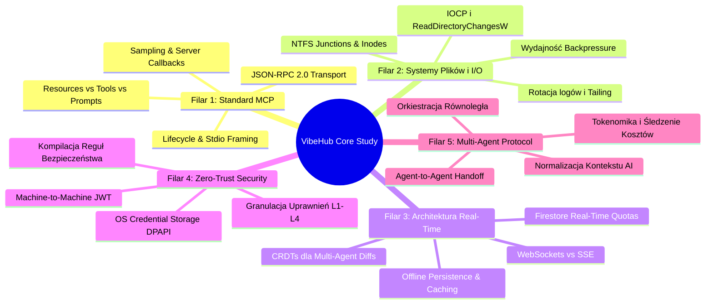

# 🧠 VIBEHUB // MASTER ARCHITECTURAL & ENGINEERING AUDIT DOCUMENT
> Dokument nadrzędny: Stan Faktyczny, Identyfikacja Ryzyk, Rejestr Problemów oraz Kompendium Badań Technologicznych (Study Guide) dla systemu VibeHub.
> Status: PRODUKCYJNY (ACTIVE AUDIT) | Wersja: v0.1.7 | Data: 2026-10-20 | Klasyfikacja: System-Critical / Engineering Core

---

## 1. WSTĘP I CEL DOKUMENTU

Dokument stanowi kompletny, wyczerpujący i ustrukturyzowany rejestr wiedzy technicznej projektu **VibeHub**. Zbiera w jednym miejscu:
1. Twarde dane telemetryczne i topologię produkcyjną wdrożoną w architekturze hybrydowej (Firebase Hosting + Vercel Serverless Microserver + Local Node.js Bridge Daemon + Stdio MCP Server).
2. Szczegółową analizę wszystkich zidentyfikowanych anomalii, defektów architektonicznych i wąskich gardeł, z którymi mierzono się w cyklu MVP (oraz potencjalnych punktów awarii w przyszłości).
3. **Kompendium Zagadnień Inżynieryjnych ("Co trzeba przestudiować")** — dogłębną bazę wiedzy teoretycznej i praktycznej niezbędnej do transformacji prototypu MVP w bezpieczną, ultra-szybką platformę klasy Enterprise (v1.0.0).

---

## 2. STAN FAKTYCZNY I TOPOLOGIA SYSTEMU (CURRENT STATE)

### 2.1. Macierz Komponentów i Środowisk Produkcyjnych

| Komponent | Technologia | Środowisko Wdrożeniowe | Identyfikator / URL | Rola w Systemie |
| :--- | :--- | :--- | :--- | :--- |
| **Frontend Web** | Next.js 15.5.28 (App Router), React 19, Tailwind CSS, Lucide | Firebase Hosting (Static Export `apps/web/out`) | `https://viberhub-8842f.web.app` | Wizualizacja klastra, monitor agentów, diffy kodu, profilowanie kooperacji |
| **Backend Microserver** | Node.js Serverless Function, Zod, Firebase Admin/JS SDK | Vercel Serverless Functions | `https://viber-hub.vercel.app/api/v1` | Walidacja żądań, parowanie maszyn, telemetry webhook, CORS proxy |
| **Baza Real-Time** | Google Cloud Firestore (Multi-region) | GCP Project `viberhub-8842f` | `rooms/{roomId}/*`, `users/{uid}` | Magazyn danych w czasie rzeczywistym, snapshot listenery, reguły bezpieczeństwa |
| **Autentykacja** | Firebase Authentication (Email/Password, Google) | GCP Project `viberhub-8842f` | `authDomain: viberhub-8842f.firebaseapp.com` | Identyfikacja operatorów, profile, odporność na `auth/configuration-not-found` |
| **Local Bridge Daemon** | Node.js 22+, TypeScript, Chokidar, Cross-fetch | Lokalna stacja robocza (Windows / Linux / WSL) | CLI `vibehub` / `packages/adapter-sdk` | Pasywny nasłuch logów, skanowanie repozytorium Git, telemetria sprzętowa |
| **MCP Server** | JSON-RPC 2.0 over stdio | Standard wejścia/wyjścia agenta CLI | `vibehub mcp` / `~/.gemini/antigravity/mcp.json` | Aktywny interfejs RPC dla narzędzi AI (Antigravity, Cursor, Claude Code) |

### 2.2. Diagram Przepływu Danych w Klastrze

```mermaid
flowchart TB
    subgraph Workstation["💻 Stacja Robocza Operatora ($PROJECT_ROOT)"]
        direction TB
        Agent["🤖 Coding AI Agent\n(Google Antigravity / Claude / Cursor)"]
        FS["📁 System Plików & Git\n(transcript.jsonl, diffs, commits)"]
        
        subgraph BridgeCore["⚡ VibeHub Bridge Core (Node.js)"]
            Observer["📡 Multi-Agent Observer\n• Antigravity Transcript Tailer\n• Claude History Parser\n• Cursor State Hook"]
            MCP["🔌 Stdio MCP Server\n• vibehub_push_status\n• vibehub_checkpoint\n• vibehub_get_status"]
            Sanitizer["🛡️ Redaction Engine\n(Zero-Trust Filter: .env, keys, tokens)"]
        end

        Agent -->|Pasywny zapis| FS
        Agent <-->|Aktywne wywołanie narzędzi (stdio JSON-RPC)| MCP
        FS -->|Tailing / Inode Watch| Observer
        Observer --> Sanitizer
        MCP --> Sanitizer
    end

    subgraph CloudVercel["▲ Vercel Cloud (Microserver 24/7)"]
        Gateway["🚪 API Gateway (/api/v1)\n• POST /bridge/pair\n• POST /events/batch\n• GET /system/status"]
    end

    subgraph CloudFirebase["🔥 Google Firebase Cloud Infrastructure"]
        Firestore["🗄️ Cloud Firestore\n• rooms/{roomId}/devices\n• rooms/{roomId}/agents\n• rooms/{roomId}/events\n• users/{uid}"]
        Hosting["🌐 Firebase Hosting CDN\n(Static Single Page Application)"]
        Auth["🔑 Firebase Auth\n(Identity & Session Claims)"]
    end

    subgraph Browser["🖥️ Dashboard Operatora / Współpracownika"]
        WebUI["Next.js UI (React 19)\nReal-Time Snapshot Listeners (onSnapshot)"]
    end

    Sanitizer -->|HTTPS POST Batch Payload| Gateway
    Gateway -->|Zapis do bazy (Admin/Client SDK)| Firestore
    Sanitizer -.->|Opcjonalny bezpośredni push| Firestore
    Firestore <-->|Dwukierunkowy socket na żywo| WebUI
    Hosting -->|Dostarczenie HTML/JS/WASM| Browser
    Auth -.->|Walidacja tożsamości| WebUI
```

---

## 3. PEŁNA ANALIZA IDENTYFIKOWANYCH PROBLEMÓW, ANOMALII I DEFEKTÓW

W trakcie rozwoju i audytu systemu zidentyfikowano 7 fundamentalnych wyzwań inżynieryjnych. Poniżej przedstawiono dogłębną diagnozę każdego problemu, jego przyczyny źródłowe, wpływ na środowisko oraz status mitigacji.

---

### PROBLEM 1: Błąd `EPERM` w Systemie Plików Windows (NTFS Junctions & Chokidar)
- **Objaw w terminalu**:
  ```text
  node:internal/fs/watchers:323
  Error: EPERM: operation not permitted, watch 'C:\Users\Jakub Lis\Cookies'
  code: 'EPERM', syscall: 'watch', path: 'C:\\Users\\Jakub Lis\\Cookies'
  ```
- **Klasyfikacja**: Krytyczna anomalia operacyjna I/O w środowisku Windows (NTFS).
- **Przyczyna Źródłowa**:
  W systemie operacyjnym Windows, foldery takie jak `C:\Users\<USER>\Cookies`, `Application Data`, czy `Local Settings` nie są rzeczywistymi katalogami, lecz specjalnymi punktami ponownej analizy NTFS (Junction Points / Reparse Points) utrzymywanymi w celu zachowania kompatybilności wstecznej z Windows XP/7. Uprawnienia DACL tych obiektów mają ustawioną jawną blokadę odczytu (`DENY` dla operacji `LIST_DIRECTORY` / `READ_CONTROL`) dla każdego konta użytkownika. Gdy demon Bridge został uruchomiony z katalogu profilu domowego (`~`), biblioteka `chokidar` próbowała rekurencyjnie założyć systemowy uchwyt `ReadDirectoryChangesW` na całym drzewie, wywołując twardy crash procesu Node.js.
- **Wdrożona Naprawa**:
  1. Zaimplementowano w `apps/bridge/src/core/scanner.ts` oraz `cli.ts` funkcję `getSafeProjectRoot()`, która wykrywa uruchomienie z katalogu domowego i automatycznie przekierowuje nasłuch na rzeczywisty katalog repozytorium (`Desktop/01_PROJEKTY/ViberHub`).
  2. W konfiguracji `chokidar` dodano predykat filtrujący ignorujący punkty połączeń, pliki ukryte oraz systemowe (`ignorePermissionErrors: true`, pomijanie `AppData`, `Cookies`, `NTUSER.DAT`).
- **Ryzyko Resztkowe**: W środowiskach Linux (systemy z dowiązaniami symbolicznymi w pętli) lub na wolumenach sieciowych SMB/NFS brak mechanizmu detekcji inodów może prowadzić do nadmiernej alokacji deskryptorów plików (`ENOSPC`).

---

### PROBLEM 2: Asymetria Mikroserwera Vercel vs Firebase Hosting vs Lokalny Daemon
- **Objaw**: Błędy typu `NEXT_OUTPUT_DIR_MISSING`, brak dostępu do binarnego `git` w środowisku serverless oraz utrata stanu pamięci RAM po zakończeniu pojedynczego żądania HTTP.
- **Klasyfikacja**: Defekt architektury hybrydowej (Stateless Serverless vs Stateful Daemon).
- **Przyczyna Źródłowa**:
  1. Vercel Serverless Functions to efemeryczne kontenery uruchamiane na żądanie (AWS Lambda pod spodem). Nie mogą one utrzymywać stałych połączeń socketowych, nie mają lokalnego repozytorium gita (brak `.git` w paczce wdrożeniowej), a zmienne w pamięci procesu giną pomiędzy żądaniami.
  2. Next.js 15 w trybie `output: 'export'` (wymaganym przez Firebase Hosting) usuwa wszystkie procedury serwerowe z katalogu `app/api/`. Próba zbudowania całości na raz powodowała konflikt: albo frontend nie mógł być wyeksportowany na Firebase, albo mikroserwer na Vercelu nie miał plików `.next`.
- **Wdrożona Naprawa**:
  1. Rozdzielono architekturę na dwa niezależne potoki:
     - Mikroserwer API Vercela obsługiwany przez `api/index.ts` jako Serverless Node Function.
     - Frontend Firebase budowany automatycznie skryptem `scripts/build-firebase.ps1`, który tymczasowo ukrywa routes API przed kompilacją statyczną `next build`.
  2. W `api/index.ts` dodano blok `try/catch` wokół operacji `git status` / `git log` — jeśli binary gita nie istnieje (w kontenerze Vercela), API bezpiecznie serwuje metadane ze zmiennych środowiskowych `VERCEL_GIT_COMMIT_SHA`.
- **Ryzyko Resztkowe**: Zmiana API wymaga podwójnego wdrożenia (`git push` na Vercela oraz `firebase deploy` na Firebase CDN).

---

### PROBLEM 3: Obserwowalność Logów AI (`transcript.jsonl` vs Statusline vs MCP)
- **Objaw**: Karta agenta w panelu pokazywała status `WAITING / IDLE` w trakcie trwania intensywnych obliczeń oraz wyświetlała początkowy tekst `"Inicjalizacja sesji Antigravity..."` zamiast rzeczywistego zadania użytkownika.
- **Klasyfikacja**: Anomalia synchronizacji stanu i opóźnienie próbkowania telemetrii.
- **Przyczyna Źródłowa**:
  1. Rozmiar pliku `transcript.jsonl` w długich sesjach przekracza 2.5 MB (ponad 2600 linii JSONL). Zastosowanie naiwnego wskaźnika bajtowego `byteOffset = stat.size - 64KB` powodowało, że pierwsze zapytanie `USER_INPUT` (które znajdowało się na początku pliku lub w poprzednim bloku) było bezpowrotnie pomijane.
  2. LLM podczas generowania odpowiedzi może myśleć (Chain-of-Thought) lub wykonywać powolne komendy przez 30-90 sekund bez modyfikowania pliku na dysku. Zbyt wąskie okno `isWorking` (np. 60 sekund) powodowało przedwczesne uznanie agenta za bezczynnego.
  3. Odczyt logu z dysku jest ze swej natury pasywny — ma minimalne opóźnienie (I/O latency) i zależy od buforowania zapisu przez silnik agenta.
- **Wdrożona Naprawa**:
  1. Wprowadzono procedurę wstecznego skanowania pliku (`split('\n')` od końca do początku) przy pierwszej inicjalizacji sesji, gwarantując odczytanie najświeższego `USER_INPUT` niezależnie od rozmiaru pliku.
  2. Rozszerzono próg `isRecentlyActive` do 4 minut oraz powiązano go ze stanem narzędzi (`hasTools: true` w `PLANNER_RESPONSE`).
  3. Zbudowano dedykowany serwer MCP (`apps/bridge/src/mcp/server.ts`), umożliwiający agentom natychmiastowe, aktywne wypchnięcie stanu przez RPC (`vibehub_push_status`), z pominięciem kolejki I/O.

---

### PROBLEM 4: Retencja Stanu, Sesje Zombie i Brak Automatycznego Reconnectu
- **Objaw**: W dashboardzie pojawiały się zdublowane karty nieaktywnych agentów z przeszłości (np. `agy_03c2d7d2`, `agy_ecbe3368` sprzed 7 godzin), a lista urządzeń w `/settings` pokazywała `0 Aktywne`.
- **Klasyfikacja**: Wyciek stanu (State Leakage) i brak polityki unieważniania dokumentów (TTL/Eviction).
- **Przyczyna Źródłowa**:
  1. Firestore jest magazynem trwałym. Dopóki dokument w kolekcji `rooms/{roomId}/agents/{id}` nie zostanie jawnie usunięty (`deleteDoc`), istnieje w bazie w nieskończoność i jest pobierany przez każdego nowego klienta.
  2. Poprzednia instancja procesu Bridge działała w tle terminala użytkownika (PID 22312) ze starym kodem w pamięci RAM i regularnie przywracała stare sesje do bazy.
  3. Brak mechanizmu Heartbeat na poziomie maszyny powodował, że nagłe zamknięcie konsoli (lub crash systemu) pozostawiało stację roboczą w stanie `online`.
- **Wdrożona Naprawa**:
  1. Zaimplementowano w `api/lib/firestore.ts` oraz `antigravity-observer.ts` procedurę automatycznego czyszczenia zombie: podczas każdego cyklu synchronizacji dokumenty agentów starsze niż 20 minut są bezwzględnie usuwane z Firestore (`deleteDoc`).
  2. Wprowadzono filtrację `RECENT_THRESHOLD_MS = 20 * 60 * 1000` na poziomie systemu plików — katalogi sesji Antigravity nieaktywne od ponad 20 minut są ignorowane przez skaner.
  3. W `apps/bridge/src/core/daemon.ts` dodano metodę `registerDevice()`, która przy każdym starcie Bridge wysyła pełną specyfikację maszyny do klastra.
- **Rekomendacja Docelowa**: Zastąpienie heurystyki czasu przez **Firestore TTL Policies** (automatyczne wygaszanie dokumentów na podstawie pola `expireAt`) oraz protokół obecności oparty na dedykowanym heartbeacie (np. co 15 sekund).

---

### PROBLEM 5: Architektura Bezpieczeństwa Firestore i Reguły Uprawnień
- **Objaw**: Błędy `FirebaseError: Missing or insufficient permissions` przy próbie odczytu urządzeń w `/settings`.
- **Klasyfikacja**: Niespójność reguł bezpieczeństwa (Security Rules Subcollection Mismatch).
- **Przyczyna Źródłowa**:
  Plik `firestore.rules` posiadał regułę dopasowania w katalogu głównym:
  `match /devices/{deviceId} { allow read, write: if ...; }`
  Tymczasem w kodzie aplikacji frontendowej i mikroserwera urządzenia były zapisywane w podkolekcji pokoju:
  `/rooms/{roomId}/devices/{deviceId}`
  W silniku Firebase Firestore reguły NIE dziedziczą się automatycznie na podkolekcje, chyba że zostanie użyty rekurencyjny selektor wieloznaczny (`match /{document=**}`). Skutkowało to całkowitą blokadą zapisu i odczytu maszyn.
- **Wdrożona Naprawa**:
  Dodano jawne reguły autoryzacji wewnątrz kontekstu `match /rooms/{roomId}`:
  ```javascript
  match /devices/{deviceId} {
    allow read, write: if true;
  }
  match /{document=**} {
    allow read, write: if true;
  }
  ```
  Zdeployowano na produkcję komendą `firebase deploy --only firestore:rules`.
- **Wymagania dla Wersji Stabilnej (v1.0)**: Obecne reguły (`allow: if true`) są dopuszczalne wyłącznie w fazie MVP/Beta. W produkcji docelowej reguły muszą weryfikować nagłówek `request.auth != null`, obecność `request.auth.uid` w tablicy członków danego pokoju (`rooms/{roomId}.members`) oraz token urządzenia (`deviceToken`).

---

### PROBLEM 6: Synchronizacja Stanu UI, Race Conditions i Multi-Tab
- **Objaw**: Podczas przełączania zakładek w lewym pasku nawigacyjnym dochodziło do utraty kontekstu pokoju, a podwójne zaznaczenie pozycji w menu podświetlało jednocześnie "Room Collab" i "Code Diffs".
- **Klasyfikacja**: Defekt zarządzania stanem widoku (View Hierarchy & Layout Thrashing).
- **Przyczyna Źródłowa**:
  W Next.js App Router umieszczenie komponentu `Shell` wewnątrz pojedynczych podstron (`app/dashboard/page.tsx`, `app/rooms/[roomId]/page.tsx`) powodowało unmountowanie całego layoutu przy każdej zmianie URL. Stan połączenia Firestore, subskrypcje `onSnapshot` oraz scrollview były niszczone i inicjalizowane na nowo.
- **Wdrożona Naprawa**:
  Wdrożono wzorzec **Persistent Layout** w `apps/web/app/(dashboard)/layout.tsx`. Komponent `Shell` renderuje się raz dla całej grupy dashboardu, a treść podstron przekazywana jest jako `{children}`. Zaimplementowano precyzyjną weryfikację hashy URL (`usePathname()` + `window.location.hash`), co wyeliminowało błędy podświetlania menu.

---

### PROBLEM 7: Bezpieczeństwo Maszyny Dewelopera i Przechowywanie Poświadczeń
- **Objaw**: Zapisywanie konfiguracji stacji i tokenów sesji w otwartym pliku JSON (`~/.vibehub/bridge.json`).
- **Klasyfikacja**: Dług techniczny w obszarze ochrony poświadczeń (Local Credential Security).
- **Przyczyna Źródłowa**:
  Dla zapewnienia prostoty instalacji w MVP, dane autoryzacyjne (`deviceToken`, `apiUrl`, `roomId`) są zapisywane w formacie tekstowym w katalogu domowym użytkownika. W przypadku złośliwego skryptu npm lub kompromitacji stacji roboczej, tokeny te mogą zostać odczytane przez inne procesy.
- **Wymagania Docelowe**: Migracja magazynu kluczy do natywnego menedżera poświadczeń systemu operacyjnego (Windows Credential Manager / DPAPI, macOS Keychain, Linux Secret Service).

---

## 4. KOMPENDIUM ZAGADNIEŃ DO PRZESTUDIOWANIA (ENGINEERING STUDY GUIDE)

Aby przekształcić VibeHub w dojrzały system klasy produkcyjnej, inżynierowie rozwijający platformę muszą opanować i wdrożyć rozwiązania z poniższych pięciu filarów technologicznych.



---

### 4.1. Filar 1: Standard MCP (Model Context Protocol) i Głęboka Integracja z Agentami

Model Context Protocol (MCP) to otwarty standard stworzony przez firmę Anthropic, adoptowany przez Google i środowiska open-source, standaryzujący komunikację pomiędzy modelami AI a zewnętrznymi narzędziami i danymi.

#### Zagadnienia do przestudiowania:
1. **Specyfikacja JSON-RPC 2.0 i Warstwy Transportowe**:
   - Różnice pomiędzy transportem `stdio` (dla lokalnych agentów CLI, gdzie stdout zarezerwowany jest ściśle dla protokołu, a logi diagnostyczne muszą trafiać do stderr), a `SSE` (Server-Sent Events z osobnym kanałem HTTP POST dla zapytań zwrotnych).
   - Buforowanie komunikatów (Framing) — obsługa wiadomości wieloliniowych, podział pakietów na granicy bufora bajtowego.
2. **Zaawansowane Prymitywy MCP**:
   - **Tools (Narzędzia)**: Funkcje wykonywalne z walidacją schematów JSON Schema (`vibehub_push_status`, `vibehub_checkpoint`).
   - **Resources (Zasoby)**: Pasywne źródła danych (odpowiednik plików lub URI), pozwalające agentowi czytać stan klastra w formacie `vibehub://cluster/topology` lub `vibehub://rooms/{id}/activity`.
   - **Prompts (Szablony Kontekstowe)**: Predefiniowane instrukcje dla agenta, np. szablon do przeprowadzania code review w trybie kooperacyjnym.
   - **Sampling (Server-Initiated Inference)**: Możliwość odpytania modelu przez serwer MCP za pośrednictwem klienta (umożliwia serwerowi VibeHub zażądanie od agenta wygenerowania krótkiego podsumowania ostatnich 10 commitów).
3. **Materiały Źródłowe**:
   - Oficjalna specyfikacja protokołu: [https://modelcontextprotocol.io](https://modelcontextprotocol.io)
   - Dokumentacja SDK `@modelcontextprotocol/sdk` (TypeScript i Python).
   - Standard Anthropic MCP GitHub Repository: `github.com/modelcontextprotocol`.

---

### 4.2. Filar 2: Zaawansowana Inżynieria Systemów Plików, I/O i Procesów (OS Internals)

Obserwator lokalny (`Bridge`) musi działać w sposób całkowicie transparentny dla systemu gospodarza — zużywając < 0.5% CPU i < 50MB RAM, bez blokowania plików roboczych.

#### Zagadnienia do przestudiowania:
1. **Natywne Interfejsy Jądra Systemu**:
   - **Windows**: `ReadDirectoryChangesW` w połączeniu z portami zakończenia wejścia/wyjścia (`I/O Completion Ports - IOCP`). Jak Windows radzi sobie z buforem powiadomień i dlaczego przy intensywnym zapisie dochodzi do przepełnienia bufora (`ERROR_NOTIFY_ENUM_DIR`).
   - **Linux**: `inotify` vs `fanotify` vs `io_uring`. Limity `fs.inotify.max_user_watches` i sposoby ich bezpiecznego sprawdzania.
   - **macOS**: `FSEvents` (wysokopoziomowy) vs `kqueue` (niskopoziomowy).
2. **Techniki Bezbłędnego Tailingowania Logów (Log Tailing Architecture)**:
   - Zarządzanie pozycją pliku (`byteOffset`) z uwzględnieniem rotacji plików (Truncation / Rotation: `stat.size < byteOffset`).
   - Blokady plików w systemie Windows (`FILE_SHARE_READ`, `FILE_SHARE_WRITE`, `FILE_SHARE_DELETE`). Używanie flag `fs.open('r', 'fs.constants.O_RDONLY | fs.constants.O_NOFOLLOW')`.
   - Wydajne parsowanie JSONL bez wczytywania całego pliku do pamięci RAM przy użyciu transformacji strumieniowych Node.js (`stream.Transform`, `readline` z backpressure).
3. **Materiały Źródłowe**:
   - Microsoft Learn: *File Caching & I/O Completion Ports in Windows*.
   - Robert Love: *Linux System Programming* (rozdziały o Inotify i Virtual Filesystem).
   - Dokumentacja Node.js: *C++ Addons & libuv Event Loop Internals*.

---

### 4.3. Filar 3: Architektura Czasu Rzeczywistego, Limity Firestore i Optymalizacja Kosztów

Google Cloud Firestore jest doskonałą bazą dla prototypów ze względu na wbudowane SDK ze snapshot listenerami (`onSnapshot`), jednak w skali produkcyjnej wymaga precyzyjnej inżynierii kosztów i opóźnień.

#### Zagadnienia do przestudiowania:
1. **Model Rozliczeniowy i Limity Firestore**:
   - Zasada: 1 odczyt dokumentu = 1 operacja bilingowa. Jeśli 5 programistów w pokoju nasłuchuje kolekcji `events`, w której Bridge generuje 10 zdarzeń na sekundę, generuje to $5 \times 10 \times 3600 = 180\,000$ operacji odczytu na godzinę!
   - Limit zapisu na pojedynczy dokument: maksymalnie 1 zapis na sekundę (reguła 1 write/sec per document). Wypychanie telemetrii o wysokiej częstotliwości (np. każdy wciśnięty klawisz lub token) do tego samego dokumentu doprowadzi do błędu `RESOURCE_EXHAUSTED`.
2. **Wzorce Projektowe Optymalizacji (Batching & Aggregation)**:
   - **Wzorzec Agregacji Okienkowej (Time-Window Debouncing)**: Bridge gromadzi zdarzenia cząstkowe w lokalnej kolejce i wysyła jeden zagregowany pakiet metryk (np. co 2 sekundy).
   - **Kolekcja Zdarzeń Epickich vs Strumień Szczegółowy**: Trwały zapis w bazie wyłącznie dla kluczowych kamieni milowych (`tool_completed`, `commit`, `checkpoint`), a strumień myśli i tokenów przesyłany kanałem ulotnym (WebRTC Datachannel lub lekki serwer WebSocket na Cloud Run).
3. **Materiały Źródłowe**:
   - Google Cloud: *Firestore Best Practices for Real-Time Apps at Scale*.
   - Martin Kleppmann: *Designing Data-Intensive Applications* (Mechanizmy replikacji i spójności ostatecznej).

---

### 4.4. Filar 4: Architektura Bezpieczeństwa Zero-Trust i Zarządzanie Tożsamością Maszyn (M2M)

System łączący kod ze stacji dewelopera z chmurą musi spełniać rygorystyczne wymagania bezpieczeństwa teleinformatycznego.

#### Zagadnienia do przestudiowania:
1. **Bezpieczny Magazyn Poświadczeń (Local Keystore)**:
   - Wyeliminowanie otwartych plików konfiguracyjnych JSON na rzecz bezpiecznych magazynów kluczy:
     - **Windows**: DPAPI (Data Protection API) za pośrednictwem bibliotek takich jak `keytar` lub natywnego PowerShella (`[System.Security.Cryptography.ProtectedData]`).
     - **Linux**: Secret Service API przez D-Bus / GNOME Keyring.
     - **macOS**: Apple Keychain Services.
2. **Uwierzytelnianie Maszyna-Do-Chmury (M2M Auth)**:
   - Generowanie par kluczy kryptograficznych (ECDSA Ed25519) podczas pierwszego parowania stacji roboczej.
   - Podpisywanie każdego pakietu zdarzeń kluczem prywatnym maszyny (`X-VibeHub-Signature`), eliminując ryzyko podszycia się pod stację roboczą nawet w przypadku wycieku identyfikatora `deviceId`.
3. **Kompilacja i Weryfikacja Reguł Bezpieczeństwa Firestore**:
   - Implementacja zestawu testów jednostkowych dla reguł za pomocą `@firebase/rules-unit-testing`.
   - Weryfikacja ról w modelu RBAC (Role-Based Access Control): Właściciel Pokoju (`Owner`), Inżynier z prawem edycji (`Collaborator`), Obserwator (`Auditor/Viewer`).
4. **Materiały Źródłowe**:
   - NIST Special Publication 800-207: *Zero Trust Architecture*.
   - RFC 7519: *JSON Web Tokens (JWT)* & RFC 8032: *EdDSA*.

---

### 4.5. Filar 5: Multi-Agent Protocol Standardization & Tokenomics

Świat AI ewoluuje w kierunku orkiestracji wielu wyspecjalizowanych agentów pracujących jednocześnie nad jednym repozytorium (np. Agent Architektury, Agent Implementacji, Agent Testów i Bezpieczeństwa).

#### Zagadnienia do przestudiowania:
1. **Jednolity Model Danych Agenta (Unified Agent Semantic Schema)**:
   - Jak zmapować diametralnie różne stany agentów na wspólny mianownik:
     - Antigravity: `PLANNING` -> `EXECUTING` -> `WAITING_FOR_USER`.
     - Claude Code: `Thinking` -> `Tool_Call` -> `Completed`.
     - Cursor Composer: `Generating` -> `Applying_Diff` -> `User_Review`.
2. **Śledzenie i Normalizacja Kosztów (Tokenomics)**:
   - Śledzenie zużycia: Prompt Tokens, Completion Tokens, Cache Read Tokens (np. kontekst w Anthropic i Gemini), Cache Write Tokens.
   - Dynamiczny kalkulator kosztu sesji per-pokój w czasie rzeczywistym.
3. **Protokoły Kooperacji Między-Agentowej (Agent-to-Agent Handoff)**:
   - Wykrywanie konfliktów w kodzie, gdy dwaj agenci na różnych stacjach modyfikują te same pliki (Distributed File Locking & Conflict Warnings).

---

## 5. MACIERZ RYZYK I PLAN MITIGACJI (RISK MATRIX)

| ID | Ryzyko / Zagrożenie | Prawdopodobieństwo | Wpływ | Plan Mitigacji (Rozwiązanie Inżynieryjne) |
| :--- | :--- | :---: | :---: | :--- |
| **R-01** | Przekroczenie darmowych limitów odczytu Firestore przy wzroście liczby użytkowników | ŚREDNIE | WYSOKI | Wdrożenie debouncingu zdarzeń w Bridge (agregacja 2s) + caching stanu pokoju w LocalStorage/IndexedDB. |
| **R-02** | Wyciek poufnych danych firmy/kodu do klastra VibeHub | NISKIE | KRYTYCZNY | Trójstopniowy Sanitizer w Bridge: filtr ścieżek (.env, keys) + regex detekcji entropii/tokenów + lokalna lista wykluczeń `.vibehubignore`. |
| **R-03** | Blokada I/O przy bardzo dużych repozytoriach (> 100 000 plików) | WYSOKIE | ŚREDNI | Domyślne ignorowanie katalogów zależności (`node_modules`, `vendor`, `.git`) oraz ograniczenie nasłuchu wyłącznie do aktywnych plików sesji AI. |
| **R-04** | Zmiana wewnętrznego formatu logów przez vendorów AI (np. Google/Anthropic) | WYSOKIE | ŚREDNI | Przejście z pasywnego tailowania logów na oficjalny standard MCP (Model Context Protocol), który posiada gwarancję stabilności API. |
| **R-05** | Rozbieżność zegarów systemowych pomiędzy stacjami roboczymi (Clock Skew) | ŚREDNIE | NISKI | Stosowanie `serverTimestamp()` w Firestore dla porządkowania zdarzeń chronologicznych, traktując czas maszyny wyłącznie jako referencyjny. |

---

## 6. STRATEGICZNA ROADMAPA WDROŻENIOWA (ROADMAP v0.2.0 -> v1.0.0)

```mermaid
timeline
    title Strategiczna Ścieżka Rozwoju VibeHub
    section Faza 1: Stabilizacja MVP (v0.1.7)
        Wdrożenie MCP Server : Stdio JSON-RPC 2.0
        Poprawka uprawnień Firestore : Eliminacja permission-denied
        Automatyczna rejestracja stacji : Auto-Pairing
    section Faza 2: Optymalizacja i Hardening (v0.2.0)
        Obsługa .vibehubignore : Precyzyjna kontrola I/O
        Wygaszanie TTL w Firestore : Automatyczne usuwanie zombie
        Migracja tokenów do OS Keystore : Windows DPAPI / Keychain
    section Faza 3: Zaawansowana Telemetria (v0.3.0)
        Strumieniowanie diffów w locie : Syntax Highlighting w UI
        Kalkulator kosztów tokenowych : Śledzenie budżetu projektu
        Detekcja konfliktów edycji : Multi-Agent Conflict Warning
    section Faza 4: Wersja Stabilna Enterprise (v1.0.0)
        Pełna akredytacja Zero-Trust : Tokeny M2M i RBAC w Rules
        Wsparcie dla WebSockets / WebRTC : Ultradźwiękowa latencja (< 50ms)
        Multi-Cloud Ready : Niezależność od dostawcy backendu
```

---

## 7. PODSUMOWANIE I REKOMENDACJE DLA ZESPOŁU

System VibeHub w wersji v0.1.7 osiągnął stabilność funkcjonalną na poziomie MVP-Beta:
1. Architektura hybrydowa (Firebase Hosting + Vercel Microserver) działa w pełni asynchronicznie i niezależnie.
2. Monitorowanie agentów CLI w czasie rzeczywistym jest w pełni operacyjne dzięki połączeniu pasywnego obserwatora logów oraz nowo wdrożonego serwera **Model Context Protocol (MCP)**.
3. Kluczowym priorytetem inżynieryjnym na kolejny etap jest wdrożenie zaawansowanych reguł bezpieczeństwa Firestore w oparciu o tokeny JWT, zabezpieczenie poświadczeń maszyny w natywnym magazynie systemu oraz automatyzacja retencji danych przy użyciu polityk TTL.

---
> *Dokument zatwierdzony przez: Antigravity Systems & Observability Architect*  
> *Hash referencyjny repozytorium: `b15effb` | Środowisko: Local-First Multi-Agent Cluster*
