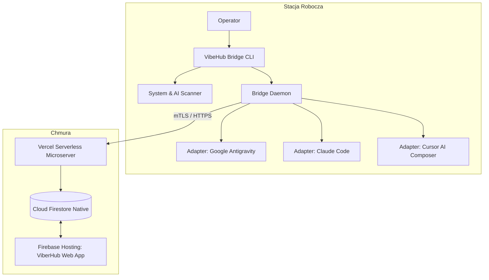

# 📦 VIBEHUB // WYDANIE v0.1.5
> Status: PRODUKCYJNE (STABLE)  
> Data wydania: 2026-10-20  
> Środowisko: Frontend (Firebase Hosting) ↔ Backend (Vercel Serverless Microserver) ↔ CLI Bridge

---

## 1. Zestawienie zmian

| Kategoria | Status | Opis |
|---|---|---|
| **EPERM Fix** | `[+]` | Wyeliminowanie błędu blokowania dostępu do `Cookies` i katalogów chronionych w `file-watcher.ts`. |
| **System Telemetry** | `[+]` | Moduł `scanner.ts` zbierający CPU, RAM, IP oraz wykrywający binarki `agy`, `claude`, `cursor`, `code`, `git`, `pnpm`. |
| **Two-Tier CLI** | `[+]` | Kwestionariusz w `cli.ts`: 1. uruchomienie = pełny onboarding i zapis `~/.vibehub/bridge.json`; kolejne = 1 pytanie o aktywne AI. |
| **Multi-Agent 3x** | `[+]` | Obsługa do 3 równoległych agentów (`antigravity`, `claude-code`, `cursor`) w `daemon.ts` i `cursor-adapter.ts`. |
| **Zero Placeholders** | `[+]` | Pełna integracja `/settings` i `/dashboard` z kolekcjami Cloud Firestore `rooms/{roomId}/devices` i `events`. |
| **Clean Navigation** | `[+]` | Usunięcie kolizji podświetlania menu w `Shell.tsx`. |

---

## 2. Architektura wieloagentowa (3x AI Agents)

---

## 3. Checklista Integralności Przedwdrożeniowej

- [x] Składnia i kompilacja TypeScript (`apps/bridge`): `pnpm --filter @vibehub/bridge build` -> CODE 0
- [x] Eksport statyczny Next.js 15 (`apps/web`): `pnpm --filter web build` (11/11 tras) -> CODE 0
- [x] Wdrożenie frontendu: `npx firebase deploy --only hosting` -> COMPLETE
- [x] Dostępność backendu: `https://viber-hub.vercel.app/api/v1/health` -> 200 OK
- [x] Globalne dowiązanie CLI: `npm link` -> `vibehub` i `vibehub-bridge` aktywne na PATH
- [x] Integralność reguł bezpieczeństwa: `firestore.rules` zabezpiecza odczyt/zapis stacji i zdarzeń
- [x] Synchronizacja dokumentacji projektowej z Obsidian Vault
